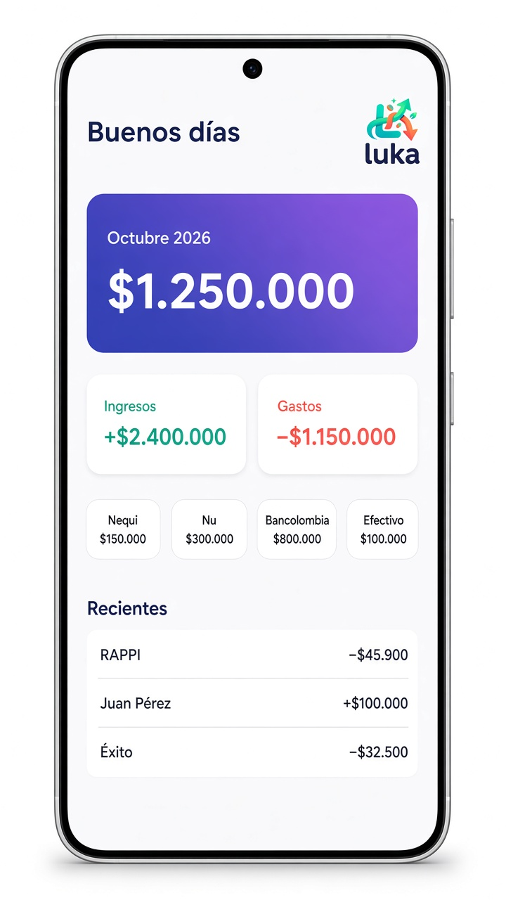
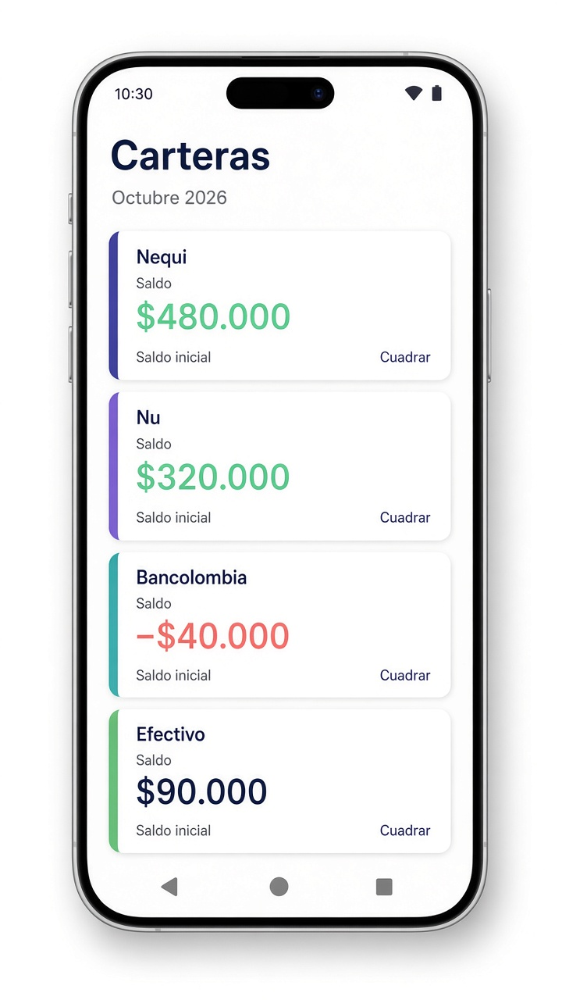
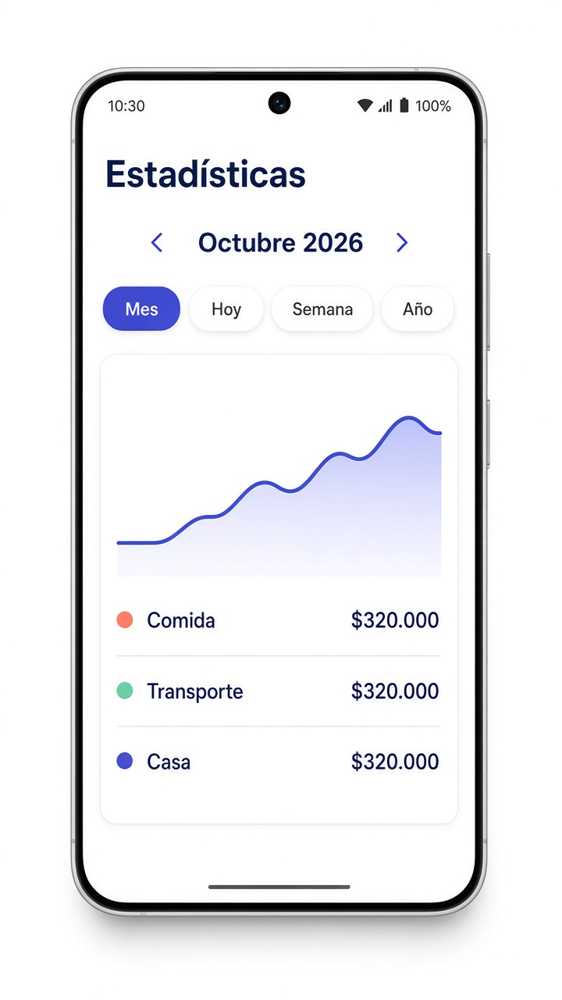

  

  Registro personal de dinero para Colombia. Luka anota lo que entra y lo que sale, en pesos, y lo ordena por cartera, categoría y mes.

  

  Android 8 o más nuevo · Se instala directo · El registro se queda en el teléfono

Luka no mueve dinero. No pide la clave de Nequi, Nu ni Bancolombia, no entra a esas cuentas y no hace transferencias. Lee solo la notificación que tú autorizas.

## Así se ve

  
  &nbsp;
  
  &nbsp;
  

  Inicio · Carteras · Estadísticas

Inicio abre con el saludo según la hora de Bogotá y el neto del mes. El número grande de esa tarjeta es lo que entró menos lo que salió en el periodo. Debajo están las carteras y los movimientos recientes.

Carteras muestra el dinero que hay en Efectivo, Nequi, Nu y Bancolombia. Ese número no es el del mes: es el saldo, y sigue vivo.

Estadísticas deja mirar hoy, la semana, el mes, el trimestre o el año. Ahí están las categorías, los ingresos, la tendencia y los comercios.

## Cómo anota sola

Cuando Nequi, Nu o Bancolombia avisa que pagaste, enviaste o recibiste, Luka crea el movimiento en ese momento. No hace falta abrir el aviso ni confirmarlo dentro de la app.

Reconoce frases como «Pagaste $25.000 a Tienda X», «Enviaste $50.000 a María» o «Recibiste $100.000 de Juan». Guarda el monto, si fue entrada o salida, y la cartera de la app que avisó.

Eso pide un permiso, una sola vez: el acceso a notificaciones. Se da en el inicio de Luka o en los ajustes del celular. Sin ese permiso Android no entrega el aviso y no hay nada que anotar.

Un mensaje que no es un movimiento no se inventa. El cupo de la tarjeta, una compra rechazada o un recordatorio de pago se quedan fuera. Si un pago real llega escrito de una forma que Luka todavía no entiende, cae en Por revisar para completarlo a mano, en vez de anotar un monto falso.

También se puede registrar a mano un gasto, un ingreso o un traslado. Si no eliges cartera, el movimiento cae en Efectivo.

## El saldo de cada cartera

El saldo parte de un número que escribes tú: lo que ves hoy en esa app. Luka no lo adivina y no entra a leerlo. A partir de ahí, cada movimiento confirmado suma o resta, de todos los meses.

Cuadrar sirve cuando el número de Luka no coincide con el que ves tú. Escribes el saldo real y Luka guarda solo la diferencia. Ese ajuste no cuenta como sueldo ni como gasto del mes.

Un traslado entre dos carteras tuyas, por ejemplo de Nequi a Bancolombia, resta en una y suma en la otra. El total no cambia y no cuenta como gasto. Un envío a otra persona sí resta, y solo de la cartera desde la que salió.

## El resto de la app

Movimientos lista lo anotado, agrupado por Hoy, Ayer o la fecha. Se filtra por gastos, ingresos, fechas, categoría y cartera. Deslizar a la derecha edita. Deslizar a la izquierda elimina, y se puede deshacer.

En Ajustes están los presupuestos, las metas y los pagos recurrentes. También se exporta el mes a CSV o a PDF, y se puede guardar una copia cifrada del registro.

Se puede pedir huella o PIN al abrir. La app se ve siempre en claro, aunque el celular esté en modo oscuro.

Los montos se muestran en pesos colombianos, por ejemplo $1.250.000. Las fechas usan la hora de Bogotá.

## Instalar

1. Toca **Descargar Luka** arriba. El archivo se llama `luka.apk`.
2. Ábrelo. Si Android pregunta, permite instalar desde el navegador o desde Archivos.
3. Abre Luka y dale el acceso a notificaciones.
4. En Carteras, escribe el saldo inicial de cada app. Desde ahí, lo que entre o salga se anota solo.

Para actualizar, baja de nuevo el APK y ábrelo encima de la instalación que ya tienes.
